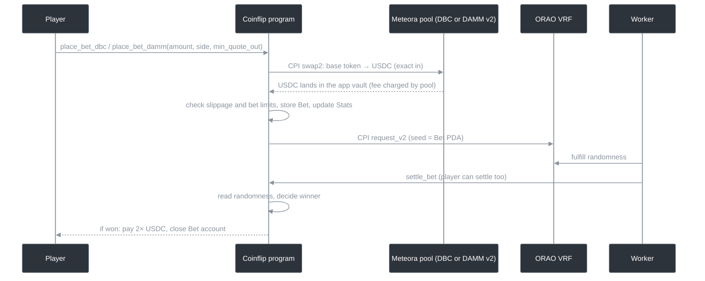

# Coinflip on Meteora: a game that earns from trading fees, not the house edge

A Solana program (Anchor) that turns a coinflip bet into a token swap. Every bet sells the player's tokens through a **Meteora Dynamic Bonding Curve (DBC)** pool, or through a **DAMM v2** pool after the curve migrates. Randomness comes from **ORAO VRF**. The game itself has zero house edge. The operator earns from the trading fees generated by the swaps.

> Built for the [Meteora DBC hackathon on Superteam Earn](https://superteam.fun/earn/listing/meteora-dbc) as a portfolio project. It is a program plus integration tests on LiteSVM. There is no devnet/mainnet deployment and no frontend.

> [!WARNING]
> **Not production-ready. Use at your own risk.** This code has not been audited and has not been deployed to any public cluster. It is published for educational and portfolio purposes only. The author accepts no liability for any loss of funds or other damage resulting from its use.

---

## The idea

A classic coinflip app makes money by giving players a negative expected value. It earns well at first, but players eventually feel the game is rigged and leave, so revenue falls off quickly.

This project flips the model:

- **The game is fair.** A winning bet pays exactly 2× the USDC the bet was worth, so the expected payout equals the bet.
- **Revenue comes from volume.** Each bet is a real sell on a Meteora pool, and the pool charges a trading fee. The operator is the DBC config partner and owns locked LP after migration, so it earns those fees.
- **Players pay a small, predictable price for the fun.** That price is the swap fee plus the VRF fee, instead of a hidden house edge, which makes repeat play more sustainable.

It works like trading but feels like a game. Coinflip is the simplest wrapper; the same approach works for other games. The point of this project is the Meteora integration that powers the fee-based revenue model.

## How it works



1. **Place a bet.** The player bets an amount of the launched token (the base token) on heads or tails. The program swaps it to USDC through Meteora by CPI, sending the output straight into the app's USDC vault (an ATA owned by the `config` PDA).
   - `place_bet_dbc` routes through the bonding curve while the token is still on the curve.
   - `place_bet_damm` routes through the DAMM v2 pool after migration. The pool address is derived from the program's stored DAMM config and the two mints. That config only lets the DBC pool authority create pools, so only the official migrated pool is accepted.
2. **Validate.** The program measures the USDC that actually arrived in the vault and checks it against the player's `min_quote_out` (slippage) and the configured `min_quote_bet` and `max_quote_bet`.
3. **Record and request randomness.** It stores a `Bet` PDA (`["bet", user, nonce]`) holding the side, the base amount sold and the USDC received. It updates the global `Stats` and requests ORAO VRF randomness seeded by the bet address.
4. **Settle.** Once the randomness is fulfilled, the worker or the player calls `settle_bet`. The lowest bit of the randomness decides heads or tails. A winner gets:

   ```
   prize = 2 × quote_amount   // USDC the bet's own swap produced
   ```

   The prize is paid in USDC from the app vault. The `Bet` account is closed and its rent goes back to whoever settled.

## Instructions

| Instruction | Who | What it does |
|---|---|---|
| `init` | admin | Creates `Config` and `Stats` and the app's USDC vault. Stores the worker, base mint, program IDs (VRF, DBC, DAMM), DBC and DAMM configs, and bet limits. |
| `place_bet_dbc` | player | Swaps the bet through the DBC pool, records the bet, requests VRF. |
| `place_bet_damm` | player | The same, through the migrated DAMM v2 pool. |
| `settle_bet` | worker or player | Reads the VRF result and pays the prize if the player won. |

## Integration notes

- **Raw CPI into Meteora without the crates.** The DBC and DAMM v2 `swap2` calls are built by hand: an Anchor `#[derive(Accounts)]` struct mirrors the callee's account order, and the instruction data is the `global:swap2` discriminator plus Borsh-encoded args. The optional referral account is passed as the callee program ID, which is how Anchor encodes `None`.
- **Balance-delta accounting.** The program does not trust any quoted amount. It reloads the vault after the swap, and the USDC actually received drives the slippage check, the bet limits and the prize.
- **One codebase for both phases of a token's life.** The same game keeps working before and after the bonding curve graduates, and both phases are covered by tests.

## Project structure

```
├── programs/coinflip/src
│   ├── instructions/        # init, place_bet_dbc, place_bet_damm, settle_bet
│   ├── cpi/                 # hand-written CPI: dbc_cpi, damm_cpi, vrf_cpi
│   ├── helpers.rs           # shared bet logic, prize calc, VRF outcome
│   └── uint256.rs
├── packages
│   ├── base/                # cluster switches, admin guard, shared errors/helpers
│   └── coinflip-api/        # account state, types, errors
├── scripts
│   ├── backend/             # IDL conversion and type codegen
│   └── common/              # TS clients for Coinflip, DBC, DAMM v2, ORAO VRF; LiteSVM config
└── tests
    ├── coinflip.test.ts     # end-to-end bet lifecycle, before and after migration
    ├── 3rd-party-programs.test.ts
    ├── litesvm-suite.ts
    └── dumps/               # dbc.so, damm_v2.so, orao_vrf.so loaded into LiteSVM
```

## Build and test

Requirements: Rust (version pinned in `rust-toolchain.toml`), Anchor, [Bun](https://bun.sh), and Node 24.

```bash
bun install
./run.sh build
bun test-vitest coinflip.test.ts
```

## Tests

Integration tests run on [LiteSVM](https://github.com/LiteSVM/litesvm). The real DBC, DAMM v2 and ORAO VRF programs are loaded from `tests/dumps`. The suite:

1. Sets up ORAO VRF (the worker is the fulfillment authority), a DAMM v2 config that only the DBC pool authority can create pools in, and a DBC config with:
   - a Token-2022 base token with a USDC quote
   - migration to DAMM v2 at 5 USDC
   - a base fee that falls from 2% to 0.3% over 60 periods
   - a 1% fee on the migrated pool
   - the partner getting 55% of the LP permanently locked
2. **Bets via DBC before migration.** It buys on the curve, bets on heads, fulfills randomness and settles. The player's USDC balance does not change at bet time, because the swap output goes to the app. On a win, the player receives 2× the USDC the swap produced.
3. **Migrates the curve to DAMM v2.** It buys enough to complete the curve, then migrates.
4. **Bets via DAMM v2 after migration.** It bets on tails through the migrated pool, fulfills and settles the same way.

## Limitations and next steps

- **Bankroll.** Prizes are paid from the app's USDC vault, which the operator seeds. There is no check at bet time that the vault can cover all pending wins. The `max_quote_bet` limit is the only risk control. A production version would track outstanding liabilities and reject bets the vault can't cover.
- **Every bet is a sell.** Steady sell pressure on the token is part of the model. A real product would need a buy side, such as players buying in through the app or wins paid out in the token.
- **Worker dependency.** Settlement relies on a worker or the player calling `settle_bet` after VRF fulfillment.
- **No deployment or UI yet.** Next steps are devnet deployment, a small web client, and more games on top of the same swap-to-play core.

## Tech stack

Rust, Anchor 0.31, Meteora Dynamic Bonding Curve, Meteora DAMM v2, ORAO VRF, Token-2022, TypeScript, Bun, Vitest, LiteSVM.

## Disclaimer

This repository is provided **as is**, without warranty of any kind, express or implied. It is not audited, not production-ready, and not intended for use with real funds. Use it at your own risk.

No license is granted. All rights reserved.